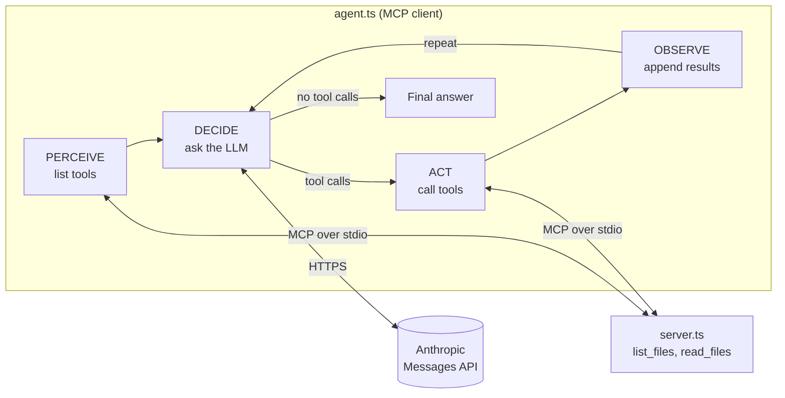

# ai-agents-mcp-typescript

A minimal, readable template for building AI agents in TypeScript that use tools over the [Model Context Protocol](https://modelcontextprotocol.io) (MCP). It includes a working MCP file server, an MCP client, and a bounded agent loop. Fork it and replace the tools and the LLM provider with your own.

## Features

- **MCP over stdio**: a server (`server.ts`) exposes tools, and the agent (`agent.ts`) connects as a client and discovers them at runtime.
- **Explicit agent loop**: Perceive, Decide, Act, Observe, Repeat. Each phase is a small, separately tested module in `phases/`.
- **Provider-agnostic LLM interface**: the loop depends on an `LLMProvider` interface. An Anthropic implementation using plain `fetch` is included.
- **Safe by default**: the loop stops after a maximum number of iterations, and oversized tool results are truncated before they reach the model.
- **No build step**: Node runs the TypeScript sources directly.
- **Tested**: unit tests with Vitest sit next to the code they cover.

## Architecture



| Phase | File | Responsibility |
| --- | --- | --- |
| Perceive | [phases/perceive.ts](phases/perceive.ts) | List the server's MCP tools and convert them to LLM tool definitions. |
| Decide | [phases/decide.ts](phases/decide.ts) | Send the conversation and tools to the LLM and return its response. |
| Act | [phases/act.ts](phases/act.ts) | Execute the requested tool calls. Failures become error results instead of exceptions. |
| Observe | [phases/observe.ts](phases/observe.ts) | Append the assistant message and tool results to the history, truncating long results. |
| Repeat | [phases/repeat.ts](phases/repeat.ts) | `runAgent`: run the loop until the model answers or `maxIterations` is reached. |

## Requirements

- Node.js 22.18 or later
- [pnpm](https://pnpm.io) 10
- An [Anthropic API key](https://console.anthropic.com)

## Quick start

```bash
pnpm install
cp .env.example .env   # then set ANTHROPIC_API_KEY in .env
pnpm agent "List the files in the current directory and summarize what this project does"
```

The prompt is the first command-line argument. Without one, the agent lists the files in the current directory. The agent starts the MCP server itself, so you do not need to run `pnpm server` separately.

## Configuration

| Setting | Where | Default |
| --- | --- | --- |
| `ANTHROPIC_API_KEY` | `.env` (loaded by `pnpm agent`) | required |
| `model` | `createAnthropicProvider({ model })` | `claude-haiku-5-5` |
| `maxTokens` | `createAnthropicProvider({ maxTokens })` | `1024` |
| `maxIterations` | `runAgent({ maxIterations })` | `10` |
| `maxToolResultChars` | `runAgent({ maxToolResultChars })` | `20000` |

## Extending the template

**Add a tool.** Register it in [server.ts](server.ts) with `server.registerTool(name, { description, inputSchema }, handler)`. The agent discovers it on the next run.

**Use another LLM.** Implement the `LLMProvider` interface from [llm/types.ts](llm/types.ts), which is a single `chat(messages, tools)` method, and pass your provider to `runAgent`. See [llm/anthropic.ts](llm/anthropic.ts) for a reference implementation.

**Use another tool backend.** `runAgent` only needs a `ToolExecutor` (a `callTool` method), so it works with any MCP client, or with a stub in tests.

## Development

```bash
pnpm test        # run the Vitest suite once
pnpm typecheck   # tsc --noEmit
pnpm server      # run the MCP server standalone (speaks MCP on stdio)
```

```text
.
├── agent.ts        # entry point: connects to the server and runs the agent
├── server.ts       # MCP file server (list_files, read_files)
├── llm/            # provider interface and Anthropic implementation
└── phases/         # perceive, decide, act, observe, repeat (with tests)
```

## Security

- The `list_files` and `read_files` tools accept **any path** and can read anything the user running the agent can access. They are not restricted to a project directory.
- Your prompt, and the contents of any files or directories the model reads, are **sent to the Anthropic API**.
- Run the agent only in directories that contain nothing sensitive, and restrict paths in `server.ts` before using it with real data.
- Never commit your `.env` file. It is listed in `.gitignore`.

## License

[MIT](LICENSE)
